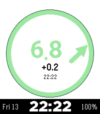

# Luped CGM

A Loop-styled glucose watchface for Pebble Time 2 and Pebble Round 2. It shows
the current glucose in a ring with a trend arrow, the change since the last
reading, and either a 12-reading graph with insulin and carbs on board and the
loop status, or a full-screen ring, plus date, time and battery. It uses the
Alloy embedded JavaScript runtime.

<table align="center">
  <tr>
    <th>Graph mode</th>
    <th>Full-screen mode</th>
  </tr>
  <tr>
    <td></td>
    <td></td>
  </tr>
</table>

Luped needs a direct watch connection from a supported iPhone app such as Loop
or Trio. It has no PebbleKit JS companion and no settings page in the Pebble
app, and it does not fetch glucose on its own: the iPhone app sends readings,
alert settings and status to the watch. The watchface is informational and must
not be used on its own to make treatment decisions; it is not medical advice.

## Supported watches

- Pebble Time 2 (`emery`, 200×228)
- Pebble Round 2 (`gabbro`, 260×260)

## Build

You need Python 3.10, Node.js, [`uv`](https://docs.astral.sh/uv/), and a
working ARM toolchain:

```sh
uv tool install --python 3.10 pebble-tool
pebble sdk install latest
npm ci
PEBBLE_BIN="$(command -v pebble)" ./scripts/build-release.sh --build --minify
```

The package is written to `build/luped-cgm.pbw`. The root `package.json` only
holds the build tooling (ESLint, Prettier, Terser); the watchface's own Pebble
package is [`variants/luped/package.json`](variants/luped/package.json).

Run without arguments to choose the variant, build, phone installation and
publication interactively. Flags run non-interactively and can be combined:

```sh
PEBBLE_BIN="$(command -v pebble)" ./scripts/build-release.sh --build --install
PEBBLE_BIN="$(command -v pebble)" ./scripts/build-release.sh --build --minify --skip-deps
PEBBLE_BIN="$(command -v pebble)" ./scripts/build-release.sh --build --install --measure-memory
PEBBLE_BIN="$(command -v pebble)" ./scripts/build-release.sh --publish --release-notes "Release notes"
```

`--install` installs on the connected phone (`--cloudpebble` installs through
CloudPebble instead). Build and publish actions install locked dependencies and
run lint and formatting checks; `npm test` runs the watch-code tests. Publishing
requires a clean `main`, pushes it to GitHub, publishes to the RePebble store and
creates a GitHub release.

Every build lists the XS machine the C stub asks for (52 KB from the app heap)
and every module in the archive, flagging any the watchface does not import.
What runs out first is XS memory, not the archive size: `--install
--measure-memory` builds with the firmware's memory counters, restarts the
watchface with logs on, prints its XS memory on the watch, then restarts it
without them (the counters wake the watch every second; never publish that
build), for example:

```text
XS memory on the watch (peak of 15 samples; used includes garbage not yet collected):
  slots      15296 /   32752 B   46.7%
  chunks      6212 /   16384 B   37.9%
  stack       2240 /    4096 B   54.7%
  app heap free for PebbleOS: 28748 B
```

## Variants

The script assembles [`src/embeddedjs/main.js.in`](src/embeddedjs/main.js.in)
for a variant, selected with `--variant` (default `luped`), using the palette,
text and compile-time flags in `variants/<variant>/watchface-config.json`. Lines
between `// @if <flag>`, `// @else` and `// @endif` are kept or dropped before the
Moddable bytecode compile, so there is no runtime variant overhead. Each variant
also has its own `package.json` (name, UUID, version), `wscript`, Moddable
manifest, C stub and menu icon under `variants/<variant>/`.

`allowShakeDebugActionTestOnly` (`false`) is for test builds: set to `true`, a
shake sends a fixed watch request (`SHAKE_DEBUG_ACTION` in `main.js.in`:
`mute:30`, or a signed bolus such as `signedforcedbolus:0.1:1`). `--publish`
refuses to run while it is on.

## Luped Remote (`lupedhelper`)

Luped Remote is a watchapp (not a watchface) built from the same template and
phone protocol as Luped, so it can use the buttons:

```sh
PEBBLE_BIN="$(command -v pebble)" ./scripts/build-release.sh --variant lupedhelper --build --minify
```

The package is written to `build/luped-remote.pbw`. The phone app must publish
a watch connection for the remote's own UUID
(`738255f4-b58b-41cd-a7ae-27fc80e81fcb`) before it connects; until then it shows
its connecting screen.

- **Open it with one press of Up:** on the watch, go to **Settings → Quick
  Launch → Tap Up** and choose **Luped Remote**. A single press of Up on the
  watchface then opens it (Tap Up opens Health by default; Hold Up, Tap Down
  and Hold Down work the same way). Apps and phone apps can't set this, so it is
  a one-time step on the watch.
- **Main screen:** glucose in the phone's units (the phone chooses them), trend
  arrow, delta and reading time, IOB and COB, one status line (connection,
  or a request's answer from `RESULT`) and the action list.
- **Buttons:** Up/Down move through the actions, Select opens one, Back closes
  the app. In an amount picker Up/Down change the amount by the step from the
  settings and Select continues. Every request then needs a confirmation
  screen before anything is sent: press the top and bottom right buttons (Up and
  Down) together (within half a second) and hold both for 2 seconds while a bar
  fills; letting go early sends nothing. Back cancels. Select alone doesn't send.
- **Sending:** after the hold, a Sending screen with a turning wheel shows until
  the phone answers, then Done or Not done (with the reason) and a buzz: short
  when done, double when not. Back hides the wheel. Without a phone connection
  the actions are dimmed and can't be opened.
- **Actions:** Mute alerts (`mute:<minutes>`), Add carbs (`carbs:<grams>`), End
  override (`override:cancel`), End temp target (`temptarget:cancel`), and Bolus,
  only as Luped's signed bolus (`signedbolus:<units>`), shown only after
  **Allow bolus** is turned on in Settings (off by default). The phone sends the
  watch no preset names and they can't be typed on a watch, so the remote can
  end a running override or temp target but not start one.
- **Settings** (on the watch, kept in its storage): default mute minutes, carb
  step and maximum, bolus step and maximum, Allow bolus. The phone still applies
  all of its own checks and limits.
- **Auto-close:** the app returns to the watchface after a minute without a
  button press; the header shows the seconds left. It stays open while a request
  waits for the phone's answer (up to 30 seconds).

To try the remote without a phone, set `"demoTestOnly": true` in
`variants/lupedhelper/watchface-config.json` and build: the test build shows
sample data and answers each request itself after 3 seconds. Turn it off again
afterwards; publishing refuses it.

Luped Remote shows what the phone sends; it is not medical advice and does not
replace the phone app. Check treatments on the phone and with your care team.

## Protocol and attribution

- The mobile integration contract is documented in
  [`variants/luped/PROTOCOL.md`](variants/luped/PROTOCOL.md).
- Palette and icon sources are credited in
  [`variants/luped/ATTRIBUTION.md`](variants/luped/ATTRIBUTION.md).

Luped started as a variant of
[CrimsonBear Cgm](https://github.com/dabear/CrimsonBearPebbleWatchFace), a
Nightscout watchface, and shares its history.
